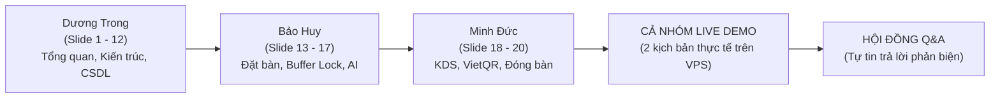
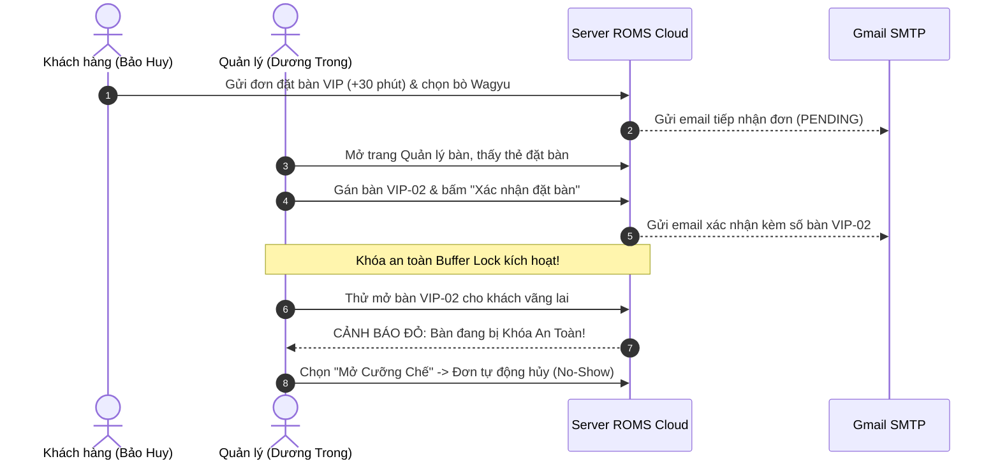
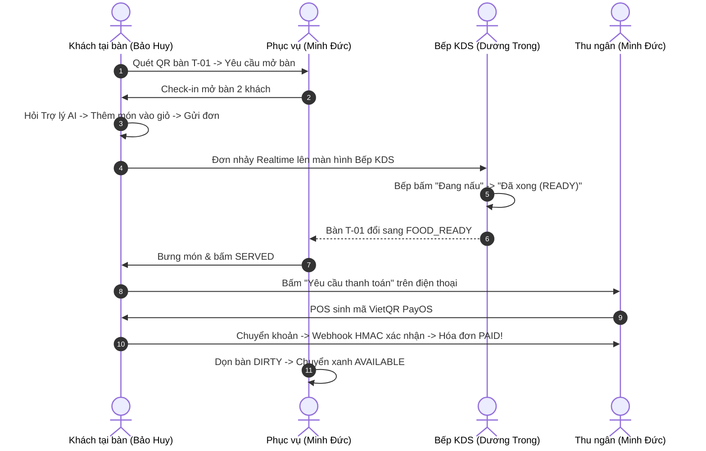

# KỊCH BẢN THUYẾT TRÌNH BẢO VỆ ĐỒ ÁN TỐT NGHIỆP SWP391
## HỆ THỐNG QUẢN LÝ VÀ GỌI MÓN NHÀ HÀNG THÔNG MINH (ROMS)
**Đại học FPT Đà Nẵng — Kỳ Fall 2026**  
**Nhóm 6 (Group 6)**  
- **Team Leader:** Dương Trong
- **Thành viên:** Ngô Viết Bảo Huy
- **Thành viên:** Phạm Minh Đức  
**Live Production:** [roms-restaurant.duckdns.org](http://roms-restaurant.duckdns.org)

---

## MỤC LỤC KỊCH BẢN
1. [Phân công vai trò & Chiến thuật thời gian (Time Management)](#1-phan-cong-vai-tro--chien-thuat-thoi-gian)
2. [Kịch bản thuyết trình Slide chi tiết (Slide 1 → Slide 20)](#2-kich-ban-thuyet-trinh-slide-chi-tiet)
   - [Phần 1: Dương Trong (Slide 1 – Slide 12)](#phan-1-duong-trong-slide-1--slide-12)
   - [Phần 2: Ngô Viết Bảo Huy (Slide 13 – Slide 17)](#phan-2-ngo-viet-bao-huy-slide-13--slide-17)
   - [Phần 3: Phạm Minh Đức (Slide 18 – Slide 20)](#phan-3-pham-minh-duc-slide-18--slide-20)
3. [Kịch bản Live Demo thực tế trên máy chủ VPS (Chi tiết từng thao tác)](#3-kich-ban-live-demo-thuc-te-tren-may-chu-vps)
   - [Kịch bản Demo A: Đặt bàn trực tuyến + Khóa an toàn + Duyệt xếp bàn](#kich-ban-demo-a-dat-ban-truc-tuyen--khoa-an-toan--duyet-xep-ban)
   - [Kịch bản Demo B: Quét QR tại bàn + AI Assistant + Bếp KDS + Phục vụ + PayOS VietQR](#kich-ban-demo-b-quet-qr-tai-ban--ai-assistant--bep-kds--phuc-vu--payos-vietqr)
4. [Bộ câu hỏi phản biện của Hội đồng (Q&A Defense) & Câu trả lời mẫu](#4-bo-cau-hoi-phan-bien-cua-hoi-dong-qa-defense)

---

## 1. PHÂN CÔNG VAI TRÒ & CHIẾN THUẬT THỜI GIAN

> [!IMPORTANT]
> **Tổng thời gian tiêu chuẩn:** 20 - 25 phút (10 phút Slide + 8-10 phút Demo + 5-7 phút Q&A).  
> **Nguyên tắc vàng:** Nói dứt khoát, không đọc lại từng chữ trên slide, tập trung vào **Giá trị nghiệp vụ (Business Value)**, **Kiến trúc kỹ thuật (Technical Depth)** và **Các điểm khác biệt của ROMS**.

| Thành viên | Trách nhiệm Slide | Trách nhiệm Demo | Trọng tâm chuyên môn |
| :--- | :--- | :--- | :--- |
| **Dương Trong** *(Leader)* | **Slide 1 → 12** *(~5 phút)* | Đóng vai **Quản lý (Manager)** & Điều phối toàn bộ luồng demo | Bối cảnh, Vấn đề, Phạm vi 10 phân hệ, Kiến trúc CSDL 14 bảng, RBAC & Bảo mật PIN |
| **Ngô Viết Bảo Huy** | **Slide 13 → 17** *(~3 phút)* | Đóng vai **Khách hàng (Customer)** trên điện thoại | Đặt bàn online, Khóa an toàn Buffer Lock, Vòng đời No-Show, Trợ lý ẩm thực AI Gemini |
| **Phạm Minh Đức** | **Slide 18 → 20** *(~2 phút)* | Đóng vai **Phục vụ (Waiter)** & **Thu ngân (Cashier)** | Luồng bưng món, POS tính thuế VAT 8%, Thanh toán VietQR PayOS Webhook HMAC, Giải phóng bàn |

---

## 2. KỊCH BẢN THUYẾT TRÌNH SLIDE CHI TIẾT

---

### PHẦN 1: DƯƠNG TRONG (SLIDE 1 → SLIDE 12)

#### 🎙️ SLIDE 1: Trang tiêu đề & Giới thiệu
- **Lời thoại:**
  > *"Lời đầu tiên, em xin gửi lời chào trân trọng nhất đến quý Thầy Cô trong Hội đồng chấm thi tốt nghiệp môn SWP391 của Đại học FPT Đà Nẵng.*  
  > *Em là **Dương Trong** – Trưởng nhóm 6. Cùng đồng hành với em hôm nay là hai thành viên: bạn **Ngô Viết Bảo Huy** và bạn **Phạm Minh Đức**.*  
  > *Hôm nay, nhóm chúng em xin được báo cáo đề tài: **ROMS – Hệ thống Quản lý và Gọi món Nhà hàng Thông minh (Restaurant Ordering Management System)**. Toàn bộ hệ thống hiện đang chạy thực tế trên máy chủ Cloud tại địa chỉ `roms-restaurant.duckdns.org`."*

#### 🎙️ SLIDE 2: Bối cảnh & 3 Điểm nghẽn nghiêm trọng vào giờ cao điểm
- **Lời thoại:**
  > *"Thưa Thầy Cô, khi vận hành nhà hàng truyền thống vào giờ cao điểm, có 3 nút thắt cổ chai lớn:*  
  > *1. **Khách hàng:** Phải chờ đợi nhân viên mang menu giấy, ghi chép tay rất dễ sót các yêu cầu đặc biệt như 'không hành, ít cay', và khách hoàn toàn bị động, không biết món của mình đang nấu hay chưa.*  
  > *2. **Bộ phận Bếp:** Phiếu giấy in nhiệt dễ ướt rách, không kiểm soát được thứ tự chế biến Vào trước - Ra trước (FIFO), dẫn đến tình trạng bàn vào sau lại có món trước. Món hết nhưng nhân viên chưa kịp báo khiến khách gọi nhầm.*  
  > *3. **Cấp Quản lý:** Phục vụ phải chạy qua chạy lại giữa bàn, bếp và quầy thu ngân gây lãng phí nhân sự; bàn khách đặt trước dễ bị nhân viên xếp nhầm cho khách vãng lai.*  
  > *ROMS ra đời để số hóa toàn diện quy trình: **Bàn ăn → Bếp KDS → Thu ngân POS**, hoàn toàn không giấy tờ và theo thời gian thực."*

#### 🎙️ SLIDE 3: Giải pháp ROMS – Hệ sinh thái số khép kín tại bàn
- **Lời thoại:**
  > *"Khác biệt với các ứng dụng POS truyền thống chỉ tập trung vào thu ngân, ROMS tạo nên một vòng tuần hoàn khép kín với 4 trụ cột cốt lõi:*  
  > *- **Zero-friction:** Khách chỉ cần quét mã QR tại bàn là gọi món ngay, không cần tải app hay cài đặt phức tạp.*  
  > *- **Real-time:** Đồng bộ tức thì giữa Khách, Phục vụ, Bếp KDS và Thu ngân qua WebSocket STOMP.*  
  > *- **Strict Control:** Mã QR động chống giả mạo kết hợp cổng xác thực của Phục vụ để đảm bảo đúng khách đúng bàn.*  
  > *- **Intelligent:** Trợ lý ảo AI gợi ý món ăn theo khẩu vị và cơ chế Khóa an toàn bàn đặt chống trùng bàn."*

#### 🎙️ SLIDE 4: 10 Phân hệ chức năng sản phẩm & Giới hạn phạm vi (Scope)
- **Lời thoại:**
  > *"Nhóm đã triển khai hoàn thiện **10 phân hệ nghiệp vụ** đã lên production:*  
  > *Từ Xác thực & Phân quyền RBAC, Quản lý sơ đồ bàn & QR động, Quản lý thực đơn, Vòng đời phiên ăn gọi món theo đợt, Màn hình Bếp KDS, Sơ đồ phục vụ & Chuông gọi bàn, Thu ngân POS thuế 8% tích hợp VietQR PayOS, Đặt bàn online có chọn món trước, Báo cáo doanh thu & Ca trực nhân viên, và Trợ lý ẩm thực AI.*  
  > *Đồng thời, nhóm xác định rõ ranh giới **Out-of-Scope**: Không làm chuỗi đa chi nhánh phức tạp, không làm app di động native, không quản lý kho nguyên vật liệu thô – để tập trung làm sâu sắc và chỉn chu nhất trải nghiệm vận hành tại chỗ của một nhà hàng cao cấp."*

#### 🎙️ SLIDE 5: Tác nhân hệ thống & Phân quyền RBAC
- **Lời thoại:**
  > *"Hệ thống phục vụ **5 tác nhân con người** (Khách hàng, Phục vụ, Bếp, Thu ngân, Quản lý) và **1 tác nhân tự động hệ thống**.*  
  > *Về bảo mật nội bộ: Nhân viên nhà hàng thao tác màn hình cảm ứng bằng **Mã PIN 6 số** mã hóa BCrypt. Nếu nhập sai 5 lần liên tiếp, tài khoản tự động bị khóa để chống tấn công dò mã (Brute-Force). Nhân viên chỉ được đăng nhập khi có lịch trực ca trong ngày. Riêng Quản lý khi quên mã PIN có thể khôi phục tức thì qua **Mã OTP gửi về Gmail** có áp dụng Rate Limiting tối đa 3 lần/10 phút."*

#### 🎙️ SLIDES 6, 7, 8: Kiến trúc Use Case 3 phân hệ
- **Lời thoại:**
  > *- **Slide 6 (Tiền sảnh - FOH):** Khách đặt bàn online, quét QR tự gọi món, gọi nhân viên, xin hóa đơn; Phục vụ mở bàn, xác nhận gọi món, bưng món.*  
  > *- **Slide 7 (Hậu sảnh - Bếp & Thu ngân):** Bếp tiếp nhận đơn FIFO, cập nhật trạng thái nấu, bật/tắt tình trạng 86 hết món; Thu ngân in phiếu tạm tính, kiểm tra thanh toán VietQR tự động.*  
  > *- **Slide 8 (Quản trị - BOH):** Quản lý cấu hình thực đơn, sơ đồ bàn, duyệt đặt bàn, xếp ca trực và tra cứu báo cáo doanh thu."*

#### 🎙️ SLIDES 9 & 10: Thiết kế Cơ sở dữ liệu & 14 Bảng chuẩn hóa
- **Lời thoại:**
  > *"Về cơ sở dữ liệu, ROMS được thiết kế theo mô hình quan hệ chuẩn hóa 3NF trên **Microsoft SQL Server 2022** gồm đúng **14 bảng lõi**:*  
  > *Tách biệt rõ ràng giữa nhóm Dữ liệu danh mục (`zones`, `restaurant_tables`, `menu_items`, `categories`), nhóm Giao dịch động tại bàn (`dining_sessions`, `orders`, `order_items`, `bills`), nhóm Đặt trước (`reservations`, `reservation_items`) và nhóm Nhân sự/Ca trực (`staffs`, `shifts`, `staff_shifts`, `service_requests`). Toàn bộ khóa ngoại và ràng buộc toàn vẹn được thiết lập chặt chẽ."*

#### 🎙️ SLIDES 11 & 12: Tổng quan 2 Luồng nghiệp vụ cốt lõi
- **Lời thoại:**
  > *"Để quý Thầy Cô có cái nhìn trực quan nhất, báo cáo hôm nay sẽ tập trung vào 2 luồng nghiệp vụ xương sống của ROMS:*  
  > *- **Luồng 1:** Đặt bàn trực tuyến trước & Khóa an toàn bàn giữ chỗ.*  
  > *- **Luồng 2:** Khách đến nhà hàng quét mã QR gọi món tại bàn, chế biến và thanh toán.*  
  > *Sau đây, em xin kính mời bạn **Ngô Viết Bảo Huy** tiếp tục trình bày chi tiết về Luồng 1 và tính năng Trợ lý AI."*

---

### PHẦN 2: NGÔ VIẾT BẢO HUY (SLIDE 13 → SLIDE 17)

#### 🎙️ SLIDE 13: Đặt bàn online có chọn trước món ăn
- **Lời thoại:**
  > *"Em xin kính chào quý Thầy Cô. Em là **Ngô Viết Bảo Huy**.*  
  > *Trên màn hình Slide 13 là giao diện Đặt bàn online của ROMS. Chúng em áp dụng các quy chuẩn validation nghiêm ngặt: Từ chối các mốc thời gian quá khứ theo thời gian thực; giới hạn số khách 1–20 người.*  
  > *Đặc biệt, khách có thể **Chọn trước món ăn**. Điểm mấu chốt kỹ thuật ở đây là: Món đặt trước được lưu vào bảng riêng `reservation_items` và **khóa cố định đơn giá (price lock)** tại thời điểm đặt. Dù nhà hàng sau đó có điều chỉnh giá menu thì quyền lợi của khách vẫn được đảm bảo tuyệt đối. Điều này giúp bếp dự báo trước nguyên liệu và chuẩn bị sẵn sàng khi khách bước vào quán."*

#### 🎙️ SLIDE 14: Điểm nhấn kỹ thuật — Khóa an toàn bàn đặt (Safe Buffer Lock)
- **Lời thoại:**
  > *"Một bài toán thực tế rất hay xảy ra ở nhà hàng là: Một bàn có khách hẹn lúc 19:30, nhưng lúc 19:00 nhân viên lại vô tình xếp khách vãng lai vào ngồi. Vì một bữa ăn kéo dài 60–90 phút, khi khách đặt bàn đến thì không còn bàn trống!*  
  > *Để giải quyết triệt để, ROMS xây dựng cơ chế **Buffer Time Lock độc quyền** với khung giờ: **Từ trước giờ hẹn 60 phút (T - 60) đến sau giờ hẹn 45 phút (T + 45)**.*  
  > *Trong khung giờ này, backend sẽ chặn đứng (HTTP 400) mọi hành vi mở bàn cho khách vãng lai, hiển thị tên khách và số phút còn lại. Trừ trường hợp Quản lý xác nhận **Mở Cưỡng Chế (Force Override)** do khách gọi báo hủy hoặc khách quá giờ không tới."*

#### 🎙️ SLIDE 15: Vòng đời đơn đặt bàn & Xử lý No-Show
- **Lời thoại:**
  > *"Vòng đời của đơn đặt bàn trải qua 4 trạng thái rõ ràng:*  
  > *`PENDING` (Chờ duyệt) → `CONFIRMED` (Đã xếp bàn & Kích hoạt Khóa an toàn) → `COMPLETED` (Khách đã đến dùng bữa) hoặc `CANCELLED` (Đã hủy).*  
  > *Nếu khách quá giờ hẹn 45 phút mà không đến (No-Show), khóa an toàn tự động hết hiệu lực để bàn quay lại đón khách khác. Khi Quản lý hủy đơn, hệ thống bắt buộc nhập lý do hủy và tự động gửi email thông báo cho khách hàng."*

#### 🎙️ SLIDE 16 & 17: Gọi món qua QR & Trợ lý ảo AI Dining Assistant
- **Lời thoại:**
  > *(Chuyển sang Slide 17)*  
  > *"Điểm nhấn công nghệ của Luồng gọi món tại bàn là **Trợ lý ẩm thực AI Dining Assistant** tích hợp mô hình Google Gemini 2.5 Flash.*  
  > *Khác với các chatbot chung chung, AI của ROMS có 3 ưu điểm vượt trội:*  
  > *1. **Grounded Advice:** Chỉ tư vấn các món ăn đang có sẵn trong Menu thực tế của nhà hàng theo thời gian thực, hiểu rõ khẩu vị ('ít cay, món nướng cho 2 người') mà không bao giờ bịa ra món không có trong quán.*  
  > *2. **Interactive Cards:** Dưới câu trả lời của AI xuất hiện các thẻ món ăn trực quan kèm giá. Khách chỉ cần chạm vào nút **'+ Thêm'** là món lập tức vào giỏ hàng chung của bàn mà không cần quay lại menu.*  
  > *3. **Cơ chế Fallback an toàn:** Nếu mạng gián đoạn, hệ thống tự động fallback gợi ý các món Best-seller, đảm bảo khách không bao giờ bị đứt quãng trải nghiệm.*  
  > *Sau đây, em xin mời bạn **Phạm Minh Đức** trình bày quy trình Chế biến, Thanh toán VietQR và Môi trường Live Demo."*

---

### PHẦN 3: PHẠM MINH ĐỨC (SLIDE 18 → SLIDE 20)

#### 🎙️ SLIDE 18: Bưng món, Thanh toán VietQR PayOS & Giải phóng bàn
- **Lời thoại:**
  > *"Em xin kính chào Thầy Cô. Em là **Phạm Minh Đức**.*  
  > *Khi Bếp KDS nhấn hoàn thành món ăn, màn hình Phục vụ đổi sang trạng thái `FOOD_READY`. Nhân viên bưng ra bàn và bấm `SERVED`.*  
  > *Khi khách bấm gọi tính tiền trên điện thoại, quầy Thu ngân POS sẽ nhận tín hiệu chuông ngay lập tức. Hóa đơn được tính tự động gồm **Tiền món + 8% thuế VAT chuẩn Bộ Tài Chính - Giảm giá**.*  
  > *Khách có thể thanh toán bằng **Mã VietQR động tích hợp cổng PayOS**: Khi khách chuyển khoản trên app ngân hàng, hệ thống nhận tín hiệu qua **Webhook bảo mật chữ ký số HMAC-SHA256**, tự động chuyển trạng thái hóa đơn sang `PAID` trong 1 giây mà thu ngân không cần bấm F5.*  
  > *Sau thanh toán, bàn chuyển sang trạng thái **`DIRTY` (Màu xám)** để phục vụ thu dọn bát đĩa, sau đó bấm dọn dẹp để bàn trở về **`AVAILABLE` (Xanh lá)** đón lượt khách mới, khép lại 1 vòng tuần hoàn hoàn chỉnh."*

#### 🎙️ SLIDE 19: Giới thiệu Môi trường Demo & Kịch bản thực tế
- **Lời thoại:**
  > *"Thưa Thầy Cô, để chứng minh tính khả thi thực tế, nhóm chúng em đã triển khai toàn bộ hệ thống lên máy chủ Cloud thực tế tại domain `roms-restaurant.duckdns.org` chạy Docker Compose gồm 4 container độc lập.*  
  > *Trong phần Live Demo ngay sau đây, nhóm em sẽ phối hợp trên các thiết bị thực tế:*  
  > *- Bạn **Bảo Huy** dùng điện thoại trong vai Khách hàng.*  
  > *- Em (**Minh Đức**) điều khiển màn hình Phục vụ & Thu ngân POS.*  
  > *- Bạn **Dương Trong** điều khiển màn hình Bếp KDS & Trang Quản trị.*  
  > *Xin kính mời quý Thầy Cô cùng theo dõi phần Live Demo thực tế của nhóm!"*

---

## 3. KỊCH BẢN LIVE DEMO THỰC TẾ TRÊN MÁY CHỦ VPS

### 🎬 KỊCH BẢN DEMO A: ĐẶT BÀN ONLINE & KHÓA AN TOÀN BUFFER LOCK (~3 phút)

1. **Bước 1: Khách đặt bàn (Bảo Huy thao tác trên điện thoại/màn hình chiếu):**
   - Truy cập `/reservation`.
   - Chọn Số khách: **4 người**, Khu vực: **VIP**, Ngày: **Hôm nay**, Giờ: **sau 30 phút nữa**.
   - Họ tên: `Nguyễn Hoàng Nam`, SĐT: `0905123456`, Email: `điền email thật của bạn hoặc Thầy Cô`.
   - Chọn trước món: Bấm chọn món *Bò Wagyu* hoặc *Cá hồi sốt cam*.
   - Bấm **"Xác Nhận Đặt Bàn"** -> Màn hình hiện mã `#RES-...`.
2. **Bước 2: Quản lý tiếp nhận & Xếp bàn (Dương Trong thao tác):**
   - Đăng nhập `MGR-001` (PIN: `123456`) -> Vào mục **Sơ đồ bàn (`/admin/tables`)**.
   - Mở tab **Đặt bàn** -> Thấy ngay đơn của khách Nguyễn Hoàng Nam vừa xuất hiện realtime.
   - Nhấn **"Xếp bàn"** -> Chọn bàn **VIP-02**.
   - Bấm **"Xác nhận đặt bàn"**. Bàn VIP-02 chuyển sang màu tím `RESERVED` kèm huy hiệu **Khóa an toàn**.
   - 👉 *Mở tab Gmail của khách: Email xác nhận HTML chính thức của nhà hàng ROMS xuất hiện ngay lập tức!*
3. **Bước 3: Thử thách tính năng "Khóa an toàn" & "Mở cưỡng chế" (Dương Trong thao tác):**
   - Quản lý click vào bàn VIP-02, giả lập trường hợp nhân viên sơ ý bấm mở bàn cho khách vãng lai.
   - Hệ thống hiển thị Modal cảnh báo màu đỏ: *"BÀN ĐANG ĐƯỢC KHÓA AN TOÀN giữ chỗ cho khách lúc ... Không thể xếp khách vãng lai!"*
   - Quản lý giới thiệu nút **"Mở cưỡng chế (Khách quá giờ / No-Show)"**: Bấm mở cưỡng chế -> Bàn mở ra cho khách vãng lai, đồng thời đơn đặt bàn của khách cũ tự động chuyển sang `CANCELLED` và unbind khỏi bàn.

---

### 🎬 KỊCH BẢN DEMO B: GỌI MÓN QR + AI CHATBOT + BẾP KDS + POS VIETQR (~5 phút)

1. **Bước 1: Quét QR & Mở bàn (Bảo Huy & Minh Đức):**
   - Khách (Bảo Huy) truy cập link QR bàn **T-01**. Bấm **"Yêu cầu mở bàn"**.
   - Phục vụ (Minh Đức) trên màn hình Phục vụ (`/waiter`) thấy bàn T-01 nhấp nháy yêu cầu mở bàn -> Chạm chọn số khách và bấm **"Check-in mở bàn"**.
   - Màn hình khách trên điện thoại tự động chuyển ngay vào Thực đơn gọi món.
2. **Bước 2: Tư vấn món với Trợ lý ảo AI Gemini (Bảo Huy thao tác):**
   - Khách bấm vào biểu tượng **Chat AI** góc dưới màn hình.
   - Gõ: *"Bàn 2 người, thích món nướng đậm đà, không ăn cay, tư vấn giúp mình"*.
   - AI phản hồi trong 2 giây: Phân tích khẩu vị và hiển thị 2 thẻ món ăn đề xuất chuẩn xác từ menu.
   - Khách bấm trực tiếp nút **`+ Thêm`** trên thẻ AI đề xuất -> Món nhảy ngay vào Giỏ hàng!
   - Khách chọn thêm 1 lon nước ngọt và bấm **"Gửi Order Bếp"**.
3. **Bước 3: Bếp KDS chế biến thời gian thực (Dương Trong điều khiển):**
   - Màn hình Bếp KDS (`/kitchen`) vang chuông thông báo và xuất hiện Ticket bàn T-01 **ngay lập tức không cần tải lại trang**.
   - *Điểm nhấn:* Món nước ngọt tự động chuyển thẳng sang quầy phục vụ; món ăn hiển thị đồng hồ đếm giây chuẩn SLA.
   - Đầu bếp bấm **"Bắt đầu nấu"** (thẻ đổi màu cam) -> Bấm **"Nấu xong"** (thẻ đổi màu xanh lá `READY`).
4. **Bước 4: Phục vụ bưng món & Chuông gọi phục vụ (Minh Đức thao tác):**
   - Trên màn hình Phục vụ, bàn T-01 đổi trạng thái **`FOOD_READY`**. Phục vụ bưng món ra bàn và bấm `Đã lên bàn (SERVED)`.
   - Khách trên điện thoại bấm nút **"Gọi phục vụ"** chọn *"Xin thêm đá lạnh"* -> Ngay lập tức chuông đỏ reo trên màn hình Phục vụ.
5. **Bước 5: Thanh toán VietQR PayOS & Giải phóng bàn (Minh Đức thao tác):**
   - Khách bấm **"Yêu cầu thanh toán"**.
   - Màn hình Thu ngân POS (`/pos`) nhảy chuông báo bàn T-01 yêu cầu tính tiền.
   - Thu ngân click bàn T-01: Hệ thống hiển thị chi tiết món ăn, tự động tính **8% VAT**.
   - Bấm **"Thanh toán VietQR"** -> Mã QR ngân hàng PayOS động hiện lên màn hình.
   - Khách thực hiện quét mã chuyển khoản thử nghiệm -> **Webhook PayOS bắn về server, xác thực chữ ký số HMAC-SHA256, hóa đơn lập tức đổi sang `PAID` xanh trong 1 giây**.
   - Thu ngân in hóa đơn, bàn T-01 tự động chuyển sang trạng thái **`DIRTY` (Màu xám)**.
   - Nhân viên phục vụ ra dọn dẹp đĩa trống, bấm nút **"Đã dọn dẹp xong"** -> Bàn T-01 trở về màu xanh **`AVAILABLE`**, sẵn sàng cho lượt khách tiếp theo!

---

## 4. BỘ CÂU HỎI PHẢN BIỆN CỦA HỘI ĐỒNG (Q&A DEFENSE)

### ❓ Câu 1 (Về Kỹ thuật Real-time): Hệ thống cập nhật thời gian thực bằng công nghệ gì? Nếu mất kết nối WebSocket thì sao?
- **Trả lời (Dương Trong / Minh Đức):**
  > *"Hệ thống ROMS sử dụng cơ chế **Hybrid Real-time (Đồng bộ lai)**:*  
  > *- Kênh chính: Sử dụng giao thức **WebSocket với STOMP broker** của Spring Boot. Khi có bất kỳ sự kiện nào (đặt món, nấu xong, thanh toán, gọi phục vụ), server sẽ broadcast tới đúng topic của client tương ứng.*  
  > *- Kênh dự phòng (Fallback): Frontend thiết lập chu kỳ Polling nền từ 4 - 6 giây/lần kết hợp lắng nghe sự kiện `visibilitychange` khi người dùng chuyển lại tab. Nếu kết nối WebSocket bị rớt do mạng di động chập chờn, hệ thống tự động fallback sang cơ chế Polling để đảm bảo dữ liệu không bao giờ bị gián đoạn."*

### ❓ Câu 2 (Về Nghiệp vụ Khóa an toàn): Tại sao lại chọn khung giờ [T-60 phút đến T+45 phút]? Nếu khách đến trễ thì sao?
- **Trả lời (Bảo Huy):**
  > *"Khung giờ này được nhóm nghiên cứu kỹ lưỡng từ hành vi ăn uống thực tế tại nhà hàng:*  
  > *- **T - 60 phút:** Một lượt ăn của khách vãng lai trung bình kéo dài từ 45 đến 75 phút. Khóa bàn trước 60 phút là khoảng đệm an toàn tuyệt đối để đảm bảo không có khách vãng lai nào đang ngồi ăn dở khi khách đặt bàn bước vào.*  
  > *- **T + 45 phút:** Nhà hàng cho phép khách đến trễ tối đa 45 phút. Sau 45 phút, hệ thống tự động coi đây là trường hợp No-Show và giải phóng khóa an toàn để đón khách khác.*  
  > *Nếu nhà hàng quá đông khách vãng lai và Quản lý đã liên hệ khách cũ xác nhận không đến, Quản lý có thể chọn tính năng **'Mở cưỡng chế' (Force Override)** để hủy đơn đặt bàn và xếp khách ngay lập tức."*

### ❓ Câu 3 (Về Trợ lý ảo AI): Làm sao đảm bảo AI không tư vấn những món ăn nhà hàng không có (Hallucination)?
- **Trả lời (Bảo Huy):**
  > *"Chúng em áp dụng kỹ thuật **Context Grounding (Neo ngữ cảnh)** khi gửi prompt lên Google Gemini:*  
  > *Trước khi gọi AI, Backend query toàn bộ danh sách các món ăn đang mở bán (`is_available = true`) trong cơ sở dữ liệu cùng với giá tiền, danh mục và mô tả. Sau đó đưa danh sách này vào System Prompt kèm chỉ thị nghiêm ngặt: 'Chỉ được gợi ý các món có trong danh sách cung cấp, tuyệt đối không bịa món'.*  
  > *Nhờ đó, AI trả về kết quả chuẩn xác 100% kèm mã ID món để frontend render nút '+ Thêm vào giỏ hàng' tức thì."*

### ❓ Câu 4 (Về Bảo mật Thanh toán): Làm sao ngăn chặn việc khách hàng làm giả thông báo chuyển khoản thành công?
- **Trả lời (Minh Đức):**
  > *"Hệ thống ROMS hoàn toàn **không dựa vào ảnh chụp màn hình chuyển khoản của khách**.*  
  > *Khi khách chuyển khoản qua VietQR PayOS, ngân hàng sẽ gửi một gói tin **Webhook** từ server PayOS trực tiếp tới máy chủ backend của ROMS.*  
  > *Backend kiểm tra tính toàn vẹn bằng cách mã hóa dữ liệu nhận được bằng thuật toán **HMAC-SHA256 với Secret Key bí mật** và so khớp với chữ ký `x-signature` của header. Chỉ khi chữ ký hợp lệ và số tiền chuyển khoản khớp 100% với giá trị hóa đơn, hệ thống mới cập nhật hóa đơn sang `PAID`."*

### ❓ Câu 5 (Về Xác thực Nhân viên): Tại sao nhóm chọn Mã PIN 6 số thay vì Tên đăng nhập và Mật khẩu dài?
- **Trả lời (Dương Trong):**
  > *"Trong môi trường F&B vận hành tốc độ cao, nhân viên phục vụ và bếp thường dùng tay ướt hoặc đeo găng tay thao tác trên màn hình cảm ứng POS/Tablet. Việc gõ mật khẩu dài có ký tự đặc biệt rất mất thời gian và dễ gõ sai.*  
  > *Mã PIN 6 số trên bàn phím Touchpad số lớn giúp nhân viên chuyển ca hoặc xác nhận quyền chỉ trong **1.5 giây**.*  
  > *Để đảm bảo an ninh, nhóm đã bọc 3 lớp bảo vệ:*  
  > *1. Mã PIN lưu trong database được băm bằng thuật toán **BCrypt** có độ muối (salt).*  
  > *2. Khóa tài khoản vĩnh viễn sau **5 lần nhập sai liên tiếp**.*  
  > *3. Chỉ cho phép đăng nhập nếu nhân viên có **lịch trực ca được duyệt** trong ngày hôm đó."*

---

## 5. LỜI KẾT VÀ BÀN GIAO PHIÊN HỎI ĐÁP

- **Dương Trong đại diện nhóm kết thúc:**
  > *"Thưa quý Thầy Cô trong Hội đồng chấm thi, phần trình bày Slide và Live Demo của Nhóm 6 đến đây đã hoàn thành. Nhóm chúng em xin chân thành cảm ơn quý Thầy Cô đã chú ý lắng nghe và rất mong nhận được những nhận xét, góp ý quý báu từ Hội đồng để hệ thống ROMS ngày càng hoàn thiện hơn nữa. Chúng em xin sẵn sàng lắng nghe các câu hỏi của Thầy Cô ạ!"*
