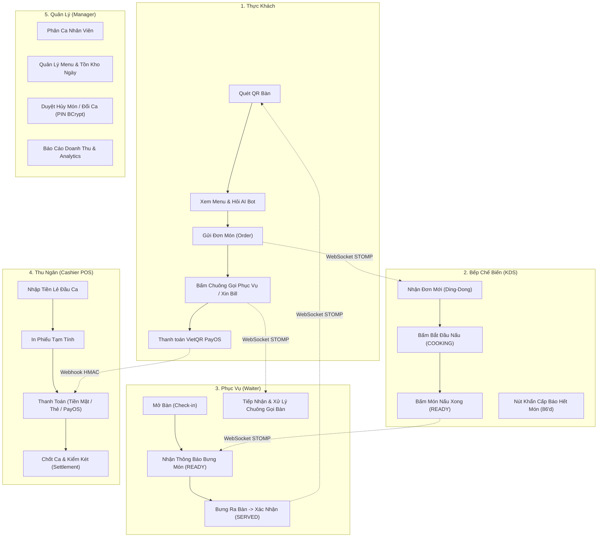
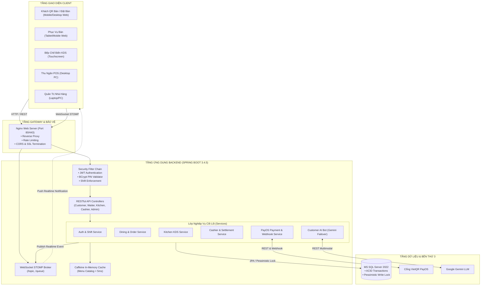
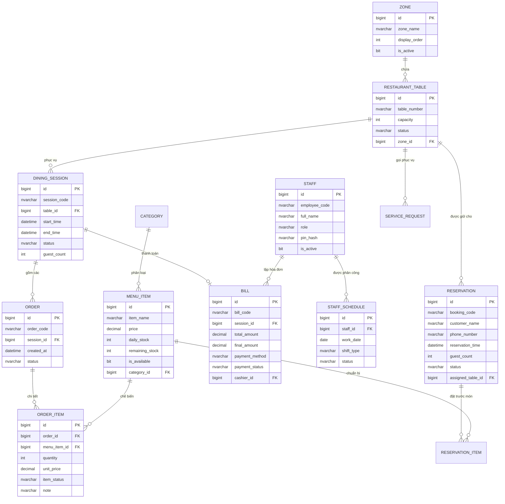

# TÀI LIỆU TOÀN DIỆN VỀ DỰ ÁN HỆ THỐNG QUẢN LÝ NHÀ HÀNG THÔNG MINH (ROMS)
## Master Project Guide: Architecture, Business Flows, Technical Highlights & Defense Cheatsheet
> **Đồ án:** SWP391 — Software Development Project | **Học kỳ:** Fall 2026 | **Đại học FPT Đà Nẵng**  
> **Nhóm thực hiện:** Nhóm 6 (Group 6 - ROMS)  
> **Môi trường Production trực tiếp:** [http://roms-restaurant.duckdns.org](http://roms-restaurant.duckdns.org) *(IP VPS: `222.255.184.250`)*  
> **Giám sát hệ sinh thái (Health Metric):** [http://roms-restaurant.duckdns.org/actuator/health](http://roms-restaurant.duckdns.org/actuator/health)

---

## 📑 MỤC LỤC ĐIỀU HƯỚNG
1. [TỔNG QUAN DỰ ÁN & BÀI TOÁN KINH DOANH (EXECUTIVE SUMMARY)](#1-tổng-quan-dự-án--bài-toán-kinh-doanh)
2. [CÁC TÁC NHÂN & LUỒNG NGHIỆP VỤ KHÉP KÍN (END-TO-END BUSINESS FLOWS)](#2-các-tác-nhân--luồng-nghiệp-vụ-khép-kín)
3. [KIẾN TRÚC HỆ THỐNG & ĐIỂM SÁNG KỸ THUẬT (TECHNICAL ARCHITECTURE)](#3-kiến-trúc-hệ-thống--điểm-sáng-kỹ-thuật)
4. [MÔ HÌNH DỮ LIỆU & QUAN HỆ THỰC THỂ (DATABASE SCHEMA & ENTITIES)](#4-mô-hình-dữ-liệu--quan-hệ-thực-thể)
5. [BẢN ĐỒ MÃ NGUỒN (SOURCE CODE MAP & DIRECTORY STRUCTURE)](#5-bản-đồ-mã-nguồn)
6. [HẠ TẦNG DEVOPS, CI/CD & GIÁM SÁT PRODUCTION](#6-hạ-tầng-devops-cicd--giám-sát-production)
7. [BỘ CÂM NANG CÂU HỎI PHẢN BIỆN HỘI ĐỒNG CHẤM THI (DEFENSE CHEATSHEET)](#7-bộ-cẩm-nang-câu-hỏi-phản-biện-hội-đồng-chấm-thi)

---

## 1. TỔNG QUAN DỰ ÁN & BÀI TOÁN KINH DOANH

### 1.1. ROMS là gì?
**ROMS (Restaurant Ordering & Management System)** là giải pháp chuyển đổi số toàn diện cho mô hình nhà hàng ẩm thực đa khu vực. Hệ thống kết nối theo thời gian thực (*real-time closed-loop*) giữa **Thực khách (Dine-in / Reservation)**, **Nhân viên Phục vụ (Waiter)**, **Bộ phận Bếp (Kitchen / KDS)**, **Thu ngân (Cashier / POS)** và **Ban Quản lý (Manager / Admin)**.

### 1.2. Các "nỗi đau" (Pain points) của nhà hàng truyền thống & Cách ROMS giải quyết
| Nỗi đau của vận hành truyền thống | Giải pháp công nghệ của ROMS |
|---|---|
| **1. Khách phải chờ đợi gọi món lâu:** Vào giờ cao điểm, nhân viên phục vụ không kịp ghi order giấy, khách vẫy tay mỏi mệt. | **Quét mã QR tại bàn:** Thực khách dùng điện thoại xem menu tương tác, hình ảnh sinh động, tự lên giỏ hàng và đặt món tức thì không cần chờ nhân viên ghi giấy. |
| **2. Bếp nhận order chậm, sai sót hoặc thất lạc giấy order:** Phiếu order giấy bị ướt, mờ chữ, bếp nấu sai yêu cầu (không cay, ít đường). | **Màn hình Bếp KDS (Kitchen Display System):** Order chuyển vào màn hình cảm ứng bếp trong <20ms qua WebSocket STOMP. Hiển thị rõ ghi chú từng món, phân loại trạng thái món bằng mã màu. |
| **3. Tranh chấp nguyên liệu / Hết món nhưng vẫn nhận order:** Khách gọi món xong 15 phút sau nhân viên mới báo "hết món". | **Khóa Bi quan (`PESSIMISTIC_WRITE`) & Nút 86'd Quick Sold-Out:** Trừ tồn kho tức thời an toàn; Bếp trưởng có thể bấm 1 nút là khóa món trên toàn bộ menu QR và POS. |
| **4. Gian lận tiền bạc & Thất thoát ca làm việc:** Thu ngân tính nhầm tiền, không khớp tiền két đầu ca - cuối ca, thất thoát tiền ăn đêm. | **Đối soát két tiền chốt ca (Shift Settlement):** Bắt buộc nhập tiền lẻ đầu ca, tự động đối soát tiền mặt/chuyển khoản, tính chênh lệch thừa/thiếu, cơ chế **Night Grace Window** quét đơn ăn khuya. |
| **5. Nhân viên vào hệ thống ngoài giờ làm việc:** Nguy cơ sửa dữ liệu, gian lận hóa đơn hoặc truy cập thông tin nội bộ trái phép. | **Kiểm soát ca trực nghiêm ngặt (Strict Shift Enforcement):** Nhân viên phục vụ/bếp/thu ngân chỉ được đăng nhập trong ca được phân công (cho phép vào trước 15 phút). Ngoài ca trực hệ thống trả về HTTP 403 Forbidden. |

---

## 2. CÁC TÁC NHÂN & LUỒNG NGHIỆP VỤ KHÉP KÍN

Hệ thống phục vụ 5 phân hệ người dùng chính:

### 2.1. Phân hệ Khách hàng tại bàn (Guest QR Ordering)
1. **Khách quét mã QR dán trên bàn:** Trình duyệt tự động mở link dạng `/table/:tableNumber` (ví dụ: `/table/B01`).
2. **Kiểm tra phiên bàn:** Nếu bàn chưa mở, hệ thống hướng dẫn bấm *"Gọi phục vụ"* để nhân viên mở bàn. Khi bàn đã có khách (`OCCUPIED`), thực khách vào thẳng menu.
3. **Trải nghiệm Menu số & Trợ lý Ẩm thực AI (ROMS Bot):**
   - Xem món ăn theo danh mục (Khai vị, Món chính, Lẩu, Đồ uống, Tráng miệng).
   - Chat với AI Bot: *"Gợi ý món lẩu cho 4 người ngân sách dưới 500k"*. AI tự lọc món còn hàng trong kho để gợi ý.
4. **Đặt món & Gửi bếp:** Chọn số lượng, thêm ghi chú (ít cay, không hành). Đơn món được lưu vào DB và lập tức bắn tín hiệu realtime qua WebSocket đến màn hình Bếp.
5. **Theo dõi tiến độ món ăn (Tracking):** Thực khách theo dõi thanh trạng thái từng món: `Đã nhận đơn` ➔ `Bếp đang nấu` ➔ `Món đã xong` ➔ `Đã lên bàn`.
6. **Thanh toán VietQR PayOS:** Khách có thể xem tạm tính, bấm chọn thanh toán chuyển khoản PayOS để quét mã VietQR tự động khớp tiền chính xác từng xu.

### 2.2. Phân hệ Đặt bàn trực tuyến (Online Reservation Portal)
1. Khách truy cập cổng đặt bàn từ xa: chọn ngày, giờ (từ `07:00` đến `21:30`), số lượng khách (1-20 khách), và khu vực mong muốn (Sảnh chính, Tầng lửng, VIP).
2. Tùy chọn đặt trước món ăn (*Pre-ordering*) giúp nhà hàng chủ động chuẩn bị nguyên liệu.
3. Sinh mã đặt chỗ duy nhất dạng `RES-yyyyMMdd-xxxx` để khách tra cứu tiến độ qua số điện thoại.
4. **Cơ chế Buffer Time Lock:** Tự động khóa bàn từ **T-60 phút** đến **T+45 phút** xung quanh giờ hẹn, ngăn ngừa nhân viên xếp khách vãng lai (*Walk-in*) vào bàn đã đặt trước.

### 2.3. Trạm Điều Phối Bếp KDS (Kitchen Display System)
- Thiết kế cho màn hình cảm ứng chuyên dụng trong bếp, hỗ trợ lọc theo danh mục món hoặc hiển thị theo bàn.
- **Mã màu chuẩn công nghiệp:**
  - `Vàng cam`: Đơn mới gửi từ khách (*ORDER_NEW*).
  - `Xanh dương`: Bếp đang nấu (*COOKING*).
  - `Xanh lá`: Món đã xong, gọi phục vụ bưng (*READY*).
- **Âm thanh Ding-Dong:** Tự động phát chuông Web Audio API báo hiệu khi có món mới rơi vào bếp.
- **Nút khẩn cấp Báo hết món (86'd Quick Sold-Out):** Bếp trưởng bấm 1 chạm để đánh dấu món hết hàng (`remainingStock = 0`, `isAvailable = false`), đồng bộ lập tức đến menu QR của khách và máy POS.

### 2.4. Trạm Phục Vụ Bàn (Waiter Mobile Terminal)
- **Sơ đồ bàn tương tác theo thời gian thực (Interactive Floor Plan):** Màu sắc bàn biểu diễn trực quan: `Trống (Xanh)`, `Có khách (Đỏ cam)`, `Cần dọn dẹp (Xám)` và `Đang rung chuông gọi (Nhấp nháy vàng)`.
- **Thao tác nhanh:** Mở bàn (Check-in), Chuyển bàn, Gộp bàn, Thêm món hộ khách.
- **Tiếp nhận món đã nấu xong:** Nhận thông báo khi bếp bấm `READY`, nhân viên bưng món đến bàn và bấm xác nhận `Đã lên bàn (SERVED)` để đồng bộ trạng thái cho khách.
- **Xử lý chuông gọi bàn:** Hiển thị danh sách các bàn đang gọi hỗ trợ (xin đá, khăn, tính tiền) kèm đồng hồ đếm thời gian chờ.

### 2.5. Thu Ngân POS & Chốt Ca (Cashier Point-Of-Sale)
- **Quản lý phiên bàn & Thanh toán:** Xem chi tiết món từng bàn, áp dụng Voucher giảm giá, xuất phiếu tạm tính (*Draft Invoice*), nhận thanh toán (Tiền mặt, Thẻ tín dụng, VietQR PayOS).
- **Hủy món an toàn:** Thao tác hủy món ăn đã gửi bếp bắt buộc phải có Quản lý nhập mã PIN BCrypt phê duyệt (`verifyManagerPin`).
- **Nghiệp vụ Chốt ca chuẩn F&B (Shift Settlement):**
  - Khai báo tiền lẻ đầu ca (*Opening Float*).
  - Kiểm đếm các mệnh giá tiền mặt cuối ca (*Denomination Breakdown*).
  - Tự động tính chênh lệch thừa/thiếu tiền két (*Cash Variance*).
  - **Cơ chế Night Grace Window:** Quét bao quát các đơn thanh toán ăn đêm đến 05:59 sáng hôm sau để không thất thoát doanh thu của ca tối.

### 2.6. Bảng Quản Trị Nhà Hàng (Manager / Admin Portal)
- **Quản lý Thực đơn & Tồn kho ngày:** Cấu hình giá, hình ảnh, định lượng tồn kho hàng ngày (*Daily Stock Allocation*).
- **Phân ca làm việc:** Lập lịch trực ca sáng/tối cho từng nhân sự.
- **Báo cáo doanh thu & Thống kê tài chính:** Biểu đồ doanh thu theo ngày/tháng, top món bán chạy, hiệu suất làm việc của nhân viên, xuất dữ liệu Excel/PDF.

---

## 3. KIẾN TRÚC HỆ THỐNG & ĐIỂM SÁNG KỸ THUẬT

### 3.1. Ngăn xếp Công nghệ (Technology Stack)
- **Backend:** Java 21 LTS, Spring Boot 3.4.5, Spring Data JPA (Hibernate 6), Spring Security 6 (Stateless JWT), Spring WebSocket STOMP, Caffeine Cache, Actuator.
- **Frontend:** React 19, Vite 8, Tailwind CSS, Lucide Icons, STOMP.js & SockJS Client, Web Audio API, Axios.
- **Database:** Microsoft SQL Server 2022 (Standard Edition).
- **Cổng thanh toán & AI:** PayOS Payment Gateway (VietQR), Google Gemini API (Multimodal LLM).
- **DevOps:** Docker, Docker Compose, Nginx Reverse Proxy, GitHub Actions CI/CD, Ubuntu Linux VPS Cloud.

---

### 3.2. Sơ đồ Kiến trúc Tổng thể (High-Level Architecture)

---

### 3.3. Các Điểm sáng Kỹ thuật Chuyên sâu (Deep Technical Highlights)

#### 1. Kiểm soát Đồng thời & Chống Race Condition (Concurrency Control)
- **Vấn đề:** Vào giờ cao điểm, 2 khách tại 2 bàn khác nhau cùng lúc nhấn gọi món cuối cùng còn lại trong kho (`remainingStock = 1`).
- **Giải pháp:** Sử dụng **Khóa Bi quan (`@Lock(LockModeType.PESSIMISTIC_WRITE)`)** trên database SQL Server:
  - Khi luồng A thực hiện trừ kho món ăn trong `CustomerDiningServiceImpl.java`, câu lệnh `SELECT ... WITH (UPDLOCK, ROWLOCK)` được kích hoạt.
  - Luồng B muốn đọc/sửa dòng dữ liệu này bắt buộc phải đợi transaction của luồng A hoàn tất.
  - Nếu số lượng yêu cầu vượt quá tồn kho thực tế, transaction tự động rollback và ném ngoại lệ thông báo hết hàng thân thiện cho khách.
  - Khóa bi quan cũng được áp dụng tương tự tại `BillRepository` và `DiningSessionRepository` để ngăn chặn thanh toán kép (*Double Spending*) hoặc xử lý trùng Webhook PayOS.

#### 2. Phân quyền & Kiểm soát Ca làm việc Nghiêm ngặt (Strict Shift Enforcement)
- **Cơ chế:** Nhân viên (Waiter, Kitchen, Cashier) sử dụng mã nhân viên (`EMP-001`) và mã PIN 6 chữ số mã hóa bằng thuật toán `BCrypt`.
- **Bảo vệ Brute-force:** Nếu nhập sai PIN liên tiếp 5 lần, tài khoản bị tạm khóa 15 phút.
- **Ràng buộc ca trực:**
  - Ca sáng (`MORNING`): `06:00 - 14:00` (cho phép điểm danh từ `05:45`).
  - Ca tối (`EVENING`): `14:00 - 22:00` (cho phép điểm danh từ `13:45`).
  - Nếu nhân viên cố tình đăng nhập ngoài ca trực (ví dụ lúc 03:00 sáng), `AuthServiceImpl.java` tự động ném `AppException(ErrorCode.FORBIDDEN)`:
    > *"Hiện tại (03:40) không nằm trong khung giờ làm việc của bất kỳ ca trực nào bạn được phân công hôm nay! Vui lòng liên hệ Quản lý."*
  - Riêng tài khoản Quản lý (`UserRole.MANAGER`) được cấp quyền truy cập 24/7 để giám sát và xử lý sự cố.

#### 3. Hệ sinh thái Real-time WebSocket STOMP bảo mật cao
- **Cấu hình STOMP Message Broker:**
  - Cho phép client lắng nghe qua các topic: `/topic/tables` (sơ đồ sàn), `/topic/kitchen` (bếp), `/topic/dining/{tableId}` (bàn của khách), `/topic/orders` (đơn hàng), `/topic/pos` (thu ngân).
- **Bảo mật kênh Inbound (Channel Interceptor):**
  - Chặn tuyệt đối không cho Client tùy tiện phát sóng tin nhắn trực tiếp qua broker (`StompCommand.SEND`).
  - Tất cả các sự kiện thay đổi dữ liệu đều phải đi qua REST API Controller ➔ được kiểm tra quyền & ghi vào DB ➔ Backend mới dùng `SimpMessagingTemplate` để phát thông báo. Điều này ngăn chặn hoàn toàn việc khách hàng can thiệp giả mạo dữ liệu.

#### 4. Trợ lý Gọi món AI với cơ chế Multi-Model Failover
- **Tích hợp:** Google Gemini REST API.
- **Chiến lược Failover 3 cấp độ:**
  1. Thử nghiệm model tối ưu nhất: `gemini-flash-lite-latest`.
  2. Nếu quá tải hoặc lỗi quota, tự động chuyển sang: `gemini-3.5-flash-lite`.
  3. Nếu tiếp tục lỗi, chuyển tiếp sang: `gemini-3.1-flash-lite`.
  4. Nếu toàn bộ dịch vụ AI bên ngoài mất kết nối, hệ thống kích hoạt **Bộ phân tích ngữ cảnh dự phòng bằng thuật toán Rule-based nội bộ** (phân tích từ khóa món ăn, ngân sách, số lượng người), đảm bảo không bao giờ để thực khách bị gián đoạn trải nghiệm.
- **Loại trừ món hết hàng:** Dữ liệu thực đơn truyền cho AI luôn được lọc bỏ các món có `isAvailable = false` hoặc `remainingStock <= 0` và lọc bỏ các món khách đã thêm vào giỏ hàng.

#### 5. Cổng thanh toán VietQR PayOS & Xác thực Webhook HMAC-SHA256
- Tự động sinh mã VietQR động theo đơn hàng với đúng số tiền cần thanh toán.
- Khi tiền vào tài khoản ngân hàng, hệ thống PayOS gửi Webhook callback về Backend.
- Backend sử dụng thuật toán mã hóa `HmacSHA256` kết hợp `Secret Key` để thẩm tra tính toàn vẹn của chữ ký số (*Signature Verification*). Bất kỳ request nào giả mạo hoặc sai chữ ký đều bị từ chối ngay lập tức.
- Sau khi xác nhận tiền về, bàn ăn tự động được chuyển sang trạng thái thanh toán thành công và gửi tín hiệu realtime đóng phiên bàn.

---

## 4. MÔ HÌNH DỮ LIỆU & QUAN HỆ THỰC THỂ

Cơ sở dữ liệu gồm 14 bảng quan hệ chặt chẽ:

### Các Vòng đời Đối tượng Trọng yếu (State Machines):
1. **Bàn ăn (`TableStatus`):**
   `AVAILABLE` (Bàn trống) ➔ `OCCUPIED` (Có khách dùng bữa) ➔ `CLEANING` (Chờ dọn dẹp) ➔ `AVAILABLE`.  
   *(Khi có khách đặt trước tới giờ: chuyển `RESERVED`)*.
2. **Phiên ăn (`SessionStatus`):**
   `ACTIVE` (Đang ăn) ➔ `COMPLETED` (Đã thanh toán kết thúc phiên) hoặc `CANCELLED` (Hủy phiên rỗng).
3. **Món ăn trong Bếp (`OrderItemStatus`):**
   `ORDER_NEW` (Khách vừa gửi) ➔ `COOKING` (Bếp đang nấu) ➔ `READY` (Nấu xong chờ bưng) ➔ `SERVED` (Đã lên bàn).  
   *(Trường hợp hết nguyên liệu: chuyển `REJECTED`)*.
4. **Hóa đơn (`BillStatus`, `PaymentStatus`):**
   `UNPAID` (Chờ thanh toán) ➔ `PAID` (Đã thu tiền thành công).
5. **Đặt bàn trước (`ReservationStatus`):**
   `PENDING` (Chờ duyệt) ➔ `CONFIRMED` (Đã xếp bàn) ➔ `CHECKED_IN` (Khách đã đến) hoặc `CANCELLED` (Khách báo hủy).

---

## 5. BẢN ĐỒ MÃ NGUỒN (SOURCE CODE MAP)

Để trả lời nhanh chóng câu hỏi của Giảng viên chấm thi *"Tính năng này em viết ở file nào?"*, dưới đây là bảng tra cứu chính xác:

### 5.1. Backend (`SourceCode/backend/roms/src/main/java/com/romsteam/roms/`)
| Phân hệ / Nghiệp vụ | Controller | Service & Implementation | File liên quan |
|---|---|---|---|
| **Đăng nhập, Phân ca, PIN** | `AuthController.java` | `AuthService.java` `AuthServiceImpl.java` | `ShiftType.java`, `SecurityConfig.java`, `JwtAuthenticationFilter.java` |
| **Khách gọi món tại bàn** | `CustomerDiningController.java` `CustomerTableController.java` | `CustomerDiningService.java` `CustomerDiningServiceImpl.java` | `MenuItemRepository.java` *(Pessimistic Lock)* |
| **Trợ lý AI Gemini** | `CustomerAiChatController.java` | `CustomerAiService.java` `CustomerAiServiceImpl.java` | `CustomerAiChatRequest.java`, `CustomerAiChatResponse.java` |
| **Màn hình Bếp KDS** | `KitchenController.java` | `KitchenService.java` `KitchenServiceImpl.java` | `KitchenOrderResponse.java`, `RealtimeService.java` |
| **Phục vụ bàn (Floor Plan)** | `WaiterController.java` | `WaiterService.java` `WaiterServiceImpl.java` | `WaiterTableResponse.java` |
| **Thu ngân, Chốt ca POS** | `CashierController.java` | `CashierService.java` `CashierServiceImpl.java` | `CloseShiftRequest.java`, `CashierShiftSummaryResponse.java` |
| **Thanh toán VietQR PayOS** | `PaymentController.java` | `PayOsService.java` `PayOsServiceImpl.java` | `BillRepository.java` *(Pessimistic Lock)* |
| **Đặt bàn từ xa** | `CustomerReservationController.java` `AdminReservationController.java` | `ReservationService.java` `ReservationServiceImpl.java` | `CreateReservationRequest.java` |
| **Báo cáo & Analytics** | `ReportController.java` | `ReportService.java` `ReportServiceImpl.java` | `ReportResponse.java` |
| **Kênh Realtime WebSocket** | *(Broker)* | `RealtimeService.java` `RealtimeServiceImpl.java` | `WebSocketConfig.java`, `RomsRealtimeEvent.java` |
| **Kiểm tra sức khỏe hệ thống** | `CustomHealthIndicator.java` | *(Spring Boot Actuator)* | `/actuator/health` |

### 5.2. Frontend (`SourceCode/frontend/src/`)
| Giao diện người dùng | Đường dẫn Route | File Component / Page chính |
|---|---|---|
| **Trang chủ & Giới thiệu** | `/` | `pages/public/LandingPage.jsx` |
| **Cổng Đặt bàn trực tuyến** | `/reservation` | `pages/public/ReservationPage.jsx` |
| **Khách quét mã QR tại bàn** | `/table/:tableNumber` | `pages/customer/TableWelcomePage.jsx` |
| **Menu thực đơn & Gọi AI** | `/table/:tableNumber/menu` | `pages/customer/CustomerMenuPage.jsx` |
| **Giỏ hàng & Xác nhận đặt món** | `/table/:tableNumber/cart` | `pages/customer/CustomerCartPage.jsx` |
| **Theo dõi tiến độ món ăn** | `/table/:tableNumber/tracking` | `pages/customer/CustomerTrackingPage.jsx` |
| **Màn hình Điều phối Bếp KDS** | `/kitchen` | `pages/kitchen/KitchenKdsPage.jsx` |
| **Trạm Phục vụ (Sơ đồ sàn)** | `/waiter` | `pages/waiter/WaiterFloorPlanPage.jsx` |
| **Thu ngân POS & Chốt ca** | `/cashier` | `pages/cashier/PosCheckoutPage.jsx` |
| **Quản lý Thực đơn & Tồn kho** | `/admin/menu` | `pages/admin/MenuManagementPage.jsx` |
| **Quản lý Bàn & Sơ đồ khu vực**| `/admin/tables` | `pages/admin/TableManagementPage.jsx` |
| **Quản lý & Phân ca Nhân viên** | `/admin/staff` | `pages/admin/StaffManagementPage.jsx` |
| **Báo cáo & Thống kê Tài chính**| `/admin/reports` | `pages/admin/ReportsAnalyticsPage.jsx` |
| **Đăng nhập Nhân viên (PIN)** | `/login` | `pages/auth/StaffLoginPage.jsx` |

---

## 6. HẠ TẦNG DEVOPS, CI/CD & GIÁM SÁT PRODUCTION

### 6.1. Kiến trúc Đóng gói Docker Compose
Hệ thống được đóng gói thành cụm dịch vụ tự chứa (*Self-contained Containers*):
- `roms-backend`: Image build từ mã nguồn Java 21 LTS (`eclipse-temurin:21-jre-alpine`).
- `roms-frontend`: Image build từ mã nguồn React 19 Vite, phân phối qua Web Server `nginx:alpine`.
- `roms-sqlserver`: Container chạy Microsoft SQL Server 2022 Linux.
- `roms-db-init`: Container tự động chạy script khởi tạo Database, cấp quyền và nạp dữ liệu mẫu ban đầu.

### 6.2. Pipeline CI/CD GitHub Actions
- Mỗi khi có Pull Request hoặc Commit đẩy vào nhánh `develop` hoặc `main`, workflow GitHub Actions tự động:
  1. Khởi động môi trường kiểm thử Java 21 & Maven.
  2. Biên dịch mã nguồn Backend và chạy trọn bộ **89/89 Unit & Integration Tests**.
  3. Kiểm tra tính hợp lệ cú pháp Frontend bằng `oxlint` và build thử `vite build`.
  4. Nếu toàn bộ test vượt qua 100%, code mới được phép merge.

### 6.3. Giám sát Vận hành Trực tiếp (Health Metric)
Truy cập endpoint: `http://roms-restaurant.duckdns.org/actuator/health`
Hệ thống trả về thông số vận hành sống thực tế của nhà hàng:
- Trạng thái kết nối Cơ sở dữ liệu SQL Server (`db.status = UP`).
- Dung lượng ổ cứng lưu trữ (`diskSpace.status = UP`).
- Kết nối dịch vụ gửi Email thông báo SMTP (`mail.status = UP`).
- **Thước đo vận hành nhà hàng chuyên sâu (`restaurantOperational`):**
  - Trạng thái nhà hàng: `RESTAURANT_ONLINE`.
  - Tổng số bàn: `10 bàn`.
  - Số bàn đang có khách: `4 bàn`.
  - Số bàn trống sẵn sàng phục vụ: `2 bàn`.
  - Số phiên ăn đang diễn ra: `4 phiên`.
  - Số lượng món ăn đang được chế biến trong bếp: `4 món`.

---

## 7. BỘ CẨM NANG CÂU HỎI PHẢN BIỆN HỘI ĐỒNG CHẤM THI

Dưới đây là 10 câu hỏi "sát sườn" nhất mà Hội đồng chấm thi FPT thường đặt ra, kèm câu trả lời mẫu chuẩn kỹ thuật:

### ❓ Câu 1: Tại sao nhóm không dùng Optimistic Lock mà lại dùng Pessimistic Lock khi trừ tồn kho món ăn?
> **Trả lời:**  
> Trong mô hình F&B giờ cao điểm, các món "Signature" (đặc sản) hoặc món giới hạn số lượng thường có tần suất tranh chấp cực cao. Nếu dùng Optimistic Lock (`@Version`), khi xảy ra xung đột đồng thời, hệ thống sẽ ném ra `OptimisticLockException` và bắt giao dịch phải retry lại nhiều lần, gây suy giảm hiệu năng và trải nghiệm người dùng kém (khách bấm đặt món bị văng lỗi).  
> Nhóm sử dụng **Pessimistic Write Lock (`@Lock(LockModeType.PESSIMISTIC_WRITE)`)** để xếp hàng luồng giao dịch ngay tại mức bản ghi DB (`ROWLOCK`). Giao dịch diễn ra trong vài mili-giây, đảm bảo tính nhất quán tuyệt đối (ACID) và không bao giờ xảy ra tình trạng bán vượt quá số lượng tồn kho (*Over-selling*).

---

### ❓ Câu 2: Tại sao nhóm thiết kế mã PIN 6 số cho nhân viên thay vì dùng tài khoản/mật khẩu truyền thống?
> **Trả lời:**  
> Trong môi trường nhà hàng, nhân viên phục vụ và thu ngân phải di chuyển liên tục, tay có thể bị ướt hoặc đeo găng tay, thiết bị sử dụng là màn hình cảm ứng POS hoặc điện thoại nhỏ. Việc bắt nhân viên gõ username dài và mật khẩu phức tạp mỗi lần thao tác là không khả thi và làm chậm tốc độ phục vụ.  
> Mã PIN 6 số giúp nhân viên thao tác nhanh trên bàn phím số chỉ mất 1-2 giây. Để đảm bảo an toàn tuyệt đối, hệ thống:
> 1. Mã hóa mã PIN bằng thuật toán `BCrypt`.
> 2. Cơ chế khóa tài khoản: Nhập sai PIN 5 lần liên tiếp sẽ bị khóa tạm thời 15 phút chống dò mã (*Brute-force protection*).
> 3. Kiểm soát theo ca trực: Dù có lộ mã PIN, ngoài khung giờ làm việc của ca được phân công thì kẻ xấu cũng không thể đăng nhập vào hệ thống.

---

### ❓ Câu 3: Làm thế nào hệ thống ngăn chặn nhân viên đăng nhập ngoài giờ làm việc?
> **Trả lời:**  
> Trong `AuthServiceImpl.java`, hệ thống kiểm tra danh sách ca trực trong ngày của nhân viên (`StaffSchedule`). Mỗi ca trực (`MORNING`, `EVENING`) có định nghĩa khung giờ bắt đầu và kết thúc cụ thể:
> - Ca sáng: `06:00 - 14:00` (cho phép điểm danh sớm từ `05:45`).
> - Ca tối: `14:00 - 22:00` (cho phép điểm danh sớm từ `13:45`).  
> Khi nhân viên đăng nhập, hệ thống lấy thời gian thực (`LocalTime.now()`). Nếu thời điểm hiện tại không thuộc bất kỳ ca trực nào của nhân viên trong ngày, hệ thống lập tức từ chối và ném ra ngoại lệ **HTTP 403 Forbidden**. Riêng Quản lý (`MANAGER`) được miễn trừ kiểm tra này để xử lý công việc bất cứ lúc nào.

---

### ❓ Câu 4: Khách hàng quét QR rồi ấn 2 lần nút "Đặt món" do mạng lag, hệ thống có bị tạo đơn trùng lặp và trừ kho 2 lần không?
> **Trả lời:**  
> Không. Hệ thống áp dụng cơ chế **Idempotency Guard & Transaction Isolation**:
> 1. Ở phía Frontend, nút gửi đơn tự động bị vô hiệu hóa (*disabled*) kèm trạng thái loading ngay khi khách bấm lần đầu.
> 2. Ở phía Backend, toàn bộ thao tác kiểm tra phiên bàn, trừ tồn kho và sinh order được bọc trong một `@Transactional` duy nhất với cơ chế khóa hàng dữ liệu. Các request trùng lặp đến sau sẽ bị từ chối do trạng thái phiên ăn hoặc số lượng tồn kho đã được đồng bộ chuẩn xác.

---

### ❓ Câu 5: Trợ lý AI ROMS Bot có bị "bịa đặt" (Hallucination) những món không có trong nhà hàng không?
> **Trả lời:**  
> Không. Nhóm áp dụng kỹ thuật **Context-bound Prompting (Giới hạn ngữ cảnh chặt chẽ)**:
> 1. Trước khi gửi câu hỏi của khách tới Google Gemini API, Backend tự động truy vấn danh mục món ăn thực tế hiện có trong Database.
> 2. Hệ thống chủ động lọc bỏ toàn bộ các món đã hết hàng (`remainingStock <= 0` hoặc `isAvailable = false`) và các món khách đã cho vào giỏ hàng.
> 3. Danh sách món (kèm giá và mô tả) được truyền vào System Prompt của AI với chỉ thị bắt buộc: *"Chỉ được tư vấn các món ăn nằm trong danh mục được cung cấp dưới đây, tuyệt đối không tự bịa ra món ăn khác"*.
> 4. Nếu mất mạng hoặc API Gemini gặp sự cố, hệ thống tự động kích hoạt **Bộ phân tích ngữ cảnh Rule-based nội bộ** để gợi ý món theo từ khóa và ngân sách, không để lộ lỗi kỹ thuật cho khách hàng.

---

### ❓ Câu 6: Làm sao đảm bảo Webhook thanh toán VietQR PayOS không bị hacker giả mạo gửi request ảo để quỵt tiền?
> **Trả lời:**  
> Backend kiểm tra chữ ký số bằng thuật toán **HMAC-SHA256**:
> 1. Khi có request Webhook gửi đến `/api/payment/payos/webhook`, Backend trích xuất dữ liệu giao dịch và chữ ký `signature` đính kèm trong header.
> 2. Sử dụng `Secret Checksum Key` được cung cấp riêng bởi PayOS để tính toán lại mã HMAC của payload nhận được.
> 3. So sánh 2 chữ ký: Nếu không khớp chính xác 100%, hệ thống từ chối request với mã lỗi `400 Bad Request` và ghi log cảnh báo an ninh.
> 4. Khi chữ ký hợp lệ, hệ thống dùng `PESSIMISTIC_WRITE` khóa bản ghi hóa đơn tương ứng để cập nhật trạng thái `PAID` và bắn thông báo realtime cho Thu ngân và Bàn ăn.

---

### ❓ Câu 7: Cơ chế WebSocket STOMP trong dự án có an toàn không? Khách có thể tự gửi tin nhắn vào kênh của Bếp không?
> **Trả lời:**  
> Rất an toàn. Trong cấu hình `WebSocketConfig.java`, nhóm đã cài đặt một `ChannelInterceptor` tại lớp `configureClientInboundChannel`:
> - Mọi gói tin STOMP dạng `SEND` từ phía Client cố tình gửi trực tiếp tới broker (`/topic/**` hoặc `/queue/**`) đều bị phát hiện và chặn đứng ngay lập tức với ngoại lệ `AccessDeniedException`.
> - Các kênh WebSocket chỉ đóng vai trò là kênh nhận dữ liệu một chiều từ Server gửi xuống (*Server-to-Client Broadcast/Unicast*).
> - Mọi thao tác tương tác của Client bắt buộc phải gọi qua REST API đã được bảo vệ bởi Spring Security, sau đó Backend mới là bên duy nhất có quyền phát sóng sự kiện qua `SimpMessagingTemplate`.

---

### ❓ Câu 8: Cơ chế Buffer Time Lock khi đặt bàn trực tuyến hoạt động như thế nào?
> **Trả lời:**  
> Để tránh tình trạng khách vãng lai (*Walk-in*) vào ngồi trùng bàn với khách đã đặt chỗ từ trước, `ReservationServiceImpl.java` áp dụng quy tắc khóa bàn an toàn:
> - Khóa bàn từ **T - 60 phút** đến **T + 45 phút** xung quanh giờ hẹn đặt bàn.
> - Trong khoảng thời gian này, bàn được đánh dấu trạng thái `RESERVED` trên Sơ đồ sàn của Phục vụ và POS Thu ngân, ngăn không cho nhân viên mở bàn mới (*Check-in*) cho khách khác tại bàn đó.
> - Khách đặt trước khi đến nhà hàng chỉ cần đọc SĐT hoặc mã đặt chỗ `RES-yyyyMMdd-xxxx`, nhân viên bấm Check-in là bàn lập tức chuyển sang `OCCUPIED` và kích hoạt các món đã đặt trước vào bếp chế biến.

---

### ❓ Câu 9: Cơ chế Night Grace Window trong nghiệp vụ chốt ca là gì?
> **Trả lời:**  
> Trong ngành F&B, ca tối trên lý thuyết kết thúc lúc 22:00, nhưng thực tế khách có thể ngồi ăn uống đến 23:00 hoặc 01:00 sáng hôm sau, và Thu ngân chỉ có thể kiểm đếm tiền két sau khi vị khách cuối cùng ra về.  
> Nếu truy vấn doanh thu chỉ chặn theo ngày `date = today`, các hóa đơn thanh toán sau nửa đêm (ví dụ 00:30 sáng hôm sau) sẽ bị tính sang doanh thu của ngày mới, dẫn đến việc chốt ca tối bị hụt tiền két thực tế.  
> Cơ chế **Night Settlement Grace Window** mở rộng khung giờ quét các giao dịch của ca tối kéo dài xuyên đêm tới tận **05:59 sáng ngày hôm sau**. Nhờ đó, toàn bộ doanh thu ăn khuya đều được đối soát chuẩn xác vào ca tối, không xảy ra chênh lệch tiền két (*Cash Variance*).

---

### ❓ Câu 10: Dự án đã được triển khai thực tế như thế nào?
> **Trả lời:**  
> Dự án không chỉ chạy trên môi trường giả lập localhost mà đã được đóng gói container hóa hoàn chỉnh bằng **Docker Compose** và triển khai trên **Cloud VPS Ubuntu Server** tại địa chỉ IP `222.255.184.250` với tên miền `http://roms-restaurant.duckdns.org`.  
> Hệ thống có Web Server Nginx đóng vai trò Reverse Proxy điều phối tải, hệ thống giám sát thời gian thực Spring Actuator `/actuator/health` theo dõi tình trạng CPU, RAM, Database và các chỉ số vận hành nhà hàng sống động. Quy trình CI/CD GitHub Actions bảo đảm toàn bộ 89 unit/integration tests tự động vượt qua trước khi release lên môi trường Production.

---

### 🎯 TÀI KHOẢN TRỰC CA ĐỂ BẢO VỆ ĐỒ ÁN (DEMO CREDENTIALS)
- **Quản lý (Manager):** Mã nhân viên `MGR-001` | Mã PIN: `123456` *(Đăng nhập được 24/7)*
- **Phục vụ (Waiter):** Mã nhân viên `EMP-001` | Mã PIN: `123456` *(Theo ca trực)*
- **Bếp (Kitchen):** Mã nhân viên `KDS-001` | Mã PIN: `123456` *(Theo ca trực)*
- **Thu ngân (Cashier):** Mã nhân viên `CSH-001` | Mã PIN: `123456` *(Theo ca trực)*
- **Thực khách (Khách ăn tại bàn):** Quét mã QR hoặc truy cập trực tiếp `http://roms-restaurant.duckdns.org/table/B01`

---
*Tài liệu được biên soạn phục vụ công tác đánh giá, phản biện và nghiệm thu Đồ án Tốt nghiệp / Môn học SWP391 tại Trường Đại học FPT Đà Nẵng.*
